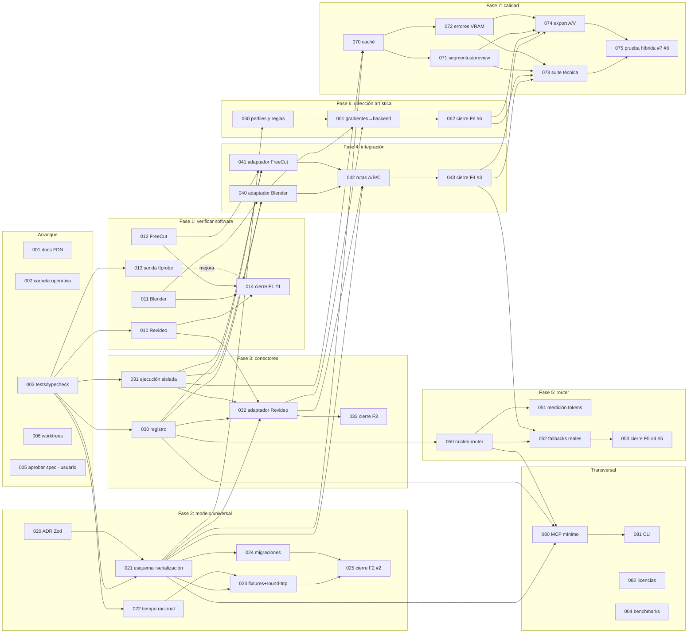

# Grafo de dependencias de tareas

> Es el grafo de **planificación**. Las dependencias de **código** se consultan con CodeGraph y Graphify ([GRAPH_TOOLS.md](GRAPH_TOOLS.md)); sirven de evidencia para este grafo, pero no lo sustituyen.
> Una arista `A --> B` significa que B no puede pasar a READY hasta que A esté DONE (integrada en `develop`).

## Paralelismo real

| Momento | Pueden ir en paralelo | Barrera |
|---|---|---|
| Tanda 1 | 004, 010, 011, 012, 021, 022, 030 (rutas disjuntas) | ninguna |
| Tanda 2 | 013, 023, 024, 031, 050 (con tarjetas simuladas), 014 | 014 espera a 010, 011 y 012 |
| Tanda 3 | 032, 040, 041, 060 | 032, 040 y 041 esperan a 031 + 030 + su verificación de la F1 |
| Tanda 4+ | 042, 051, 061, 070, 080 | 042 es una **integración conjunta** (barrera) |

Ruta crítica estimada: 003 → 031 → 032 → 042 → 043 → 052 / 073 → 075.
