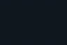

# 2026-11-25 · FDN-073c · Candidato de regresión Revideo

- **Sesión:** `codex-c1-r9` (GPT-6.2 Sol).
- **Rama:** `fdn/FDN-073c-baseline-revideo`.
- **Estado:** candidato verificado, pendiente de aceptación de A0.

## Hecho

- Reproduje la prueba de SVG de [FDN-073a](../../tests/regresion/README.md) con el motor de `69a1f4435d40b9ce3b235ca390c9f8f20132130c` (`cb2d404^`) y con el motor corregido de `cb2d404bffe69c0c17e4b9d516eeaf1075fedbed`. Los dos motores se extrajeron con `git archive` a un directorio temporal y compartieron una copia local de las dependencias instaladas. El motor de origen y el baseline registrado permanecieron intactos.
- En `cb2d404`, la escena Revideo usa `Img` con una URL de datos SVG. El primer fotograma del motor anterior muestra fondo oscuro sin la figura. El motor corregido muestra el círculo naranja sobre azul oscuro. La figura aparece parcialmente recortada en el encuadre real de la fixture. En el píxel (42, 30), el RGB cambia de (15, 23, 30) a (244, 165, 34).
- Entorno local: Windows, Node 24.21.0, Revideo 0.11.0, Chrome for Testing 157.0.8103.78 y FFmpeg/ffprobe 9.0.2.

## Verificado

| Comando o prueba | Resultado |
|---|---|
| `npm run typecheck` | Correcto. |
| `node --test --test-name-pattern 'Revideo' tests/regresion/render.test.ts`, motor original | 1/1, sin omisiones. Coincide con el baseline publicado. |
| Mismo comando con `FME_REGRESSION_CANDIDATES=1`, motor corregido | 1/1, sin omisiones. La prueba imprime el candidato. |
| Mismo comando sin modo candidato, motor corregido | Código 1 esperado, con `contentSha256 cambió` y la misma huella candidata. |
| `ffprobe -v error -select_streams v:0 -count_frames -show_entries stream=width,height,r_frame_rate,nb_read_frames -of json` | Ambos MP4 de evidencia dieron 96 × 64, 30/1 FPS y 12 fotogramas. |
| `ffmpeg -v error -i <mp4> -map 0:v:0 -c:v rawvideo -pix_fmt yuv420p -f hash -hash sha256 -` | El render conservado de cada motor reprodujo la huella de su prueba. |
| `git diff --exit-code -- tests/regresion/expected/revideo.json` | Baseline vigente intacto. |

| Comparación de la pista de vídeo | SHA-256 YUV420p |
|---|---|
| Original, baseline vigente | `7b604063831bf04028568de7312a8d1df71351881331afa37a972d9c3934f359` |
| Corregido, candidato | `2e8e4a9d68923adb31ef02d05e6e55abe617271be416c3b983631084d260e0a0` |

## Fotograma 0 para revisión de A0

Los PNG se conservan junto a esta bitácora. Los MP4 de verificación se guardaron en el temporal local de la ejecución. Extraje el primer fotograma de cada MP4 con `ffmpeg -n -v error -i <mp4> -frames:v 1 -update 1 <png>`, sin escalar.

**Original, anterior a `cb2d404`**

SHA-256 PNG `d7dcfeea3b85b2daded06cd7ec2045c6e0ac9424ba91e23fa08d739b17c4ffd6`.

**Corregido, `cb2d404`**

SHA-256 PNG `003f034724d487ca091f23e00dea50c86e839e7444e2879c94f88eb2d1158af2`.

## Pendiente

- A0 revisa la evidencia y decide si acepta la huella propuesta. Si la aprueba, actualizar únicamente `tests/regresion/expected/revideo.json` y repetir la prueba sin modo candidato.
